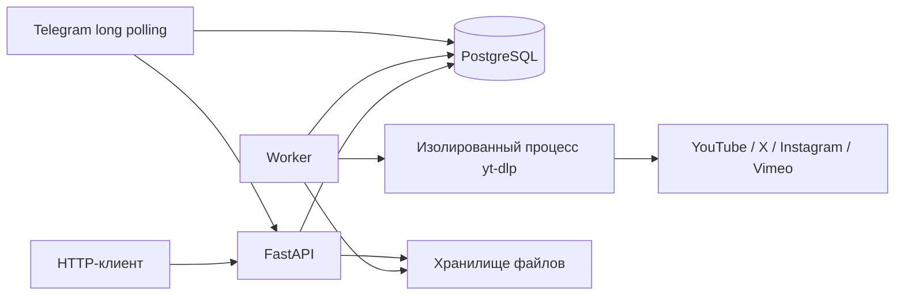

# Техническое задание: DownloadBot v0.1

## Цель

Сервис принимает ссылку на видео через HTTP API или Telegram, асинхронно скачивает
его и выдаёт файл авторизованному клиенту. Первая версия поддерживает YouTube, X,
Instagram и Vimeo через yt-dlp. PostgreSQL — единственная база данных: задания,
аккаунты, состояние воркеров, Telegram offset и связь пользователя с заданиями.

## Сценарии и границы

1. Клиент создаёт задание, получает `202 Accepted` и ID, опрашивает статус и скачивает файл.
2. Telegram принимает ссылку в личном чате от разрешённого пользователя, создаёт
   задание через тот же API и отправляет готовый файл в этот чат.
3. Администратор импортирует cookies технического аккаунта. Только разрешённый
   API-клиент может явно указать `account_id`; анонимные задания аккаунт не используют.
4. Аккаунт позволяет получить только видео, доступные самому аккаунту. Пароли,
   интерактивный вход, CAPTCHA, 2FA, DRM и покупка доступа не автоматизируются.
5. Одна ссылка — одно видео. Каналы, профили, плейлисты, live-трансляции и
   публикации с несколькими видео отклоняются. Расширение списка сервисов требует
   добавления URL-policy, extractor allowlist и тестов.

## Архитектура

API не выполняет загрузку в обработчике запроса. Воркеры атомарно забирают задания
через `FOR UPDATE SKIP LOCKED`; загрузка выполняется без открытой DB-транзакции.
Lease и heartbeat позволяют восстановить задания после аварии. Результат старого
воркера не принимается после потери lease. Каталог результата отдельный для каждой
попытки. Несколько воркеров могут работать параллельно; один технический аккаунт
обслуживает не более одной загрузки одновременно и имеет паузу между заданиями.

Базовое развёртывание — одна машина с общим диском API/воркеров. Для нескольких
машин нужны общее файловое хранилище или отдельный адаптер object storage.

## Контракт API

Все `/v1/*` требуют `Authorization: Bearer <key>`.

| Метод | Путь | Назначение |
|---|---|---|
| GET | `/healthz` | Жив ли HTTP-процесс |
| GET | `/readyz` | Доступны ли БД и heartbeat воркера |
| GET | `/v1/platforms` | Сервисы и лимиты |
| POST | `/v1/jobs` | `{url, max_height?, account_id?}`; `Idempotency-Key` опционален |
| GET | `/v1/jobs` | Последние задания клиента, `limit` 1–100 |
| GET | `/v1/jobs/{id}` | Статус, метаданные, безопасная ошибка |
| POST | `/v1/jobs/{id}/cancel` | Отмена очереди или запрос остановки загрузки |
| GET | `/v1/jobs/{id}/file` | Авторизованная выдача файла, включая Range |
| POST | `/v1/accounts` | Импорт/обновление аккаунта, только admin |
| GET | `/v1/accounts` | Метаданные аккаунтов без cookies, только admin |
| PUT | `/v1/accounts/{id}/cookies` | Ротация сессии, только admin |
| DELETE | `/v1/accounts/{id}` | Отключение и удаление зашифрованных cookies |

Состояния: `queued → running → succeeded / failed / cancelled`; истёкшие результаты
становятся `expired`. Временные сетевые ошибки и rate limit допускают ограниченное
число повторов с задержкой. Истечение TTL закрывает доступ к файлу сразу; уборщик
удаляет файл позже. Метаданные заданий сохраняются для аудита и идемпотентности.

Одинаковый `Idempotency-Key` в пределах клиента возвращает существующее задание;
другие параметры с тем же ключом дают `409`. Чужое задание даёт `404`. Неадминистратор
не видит чужие задания или аккаунты. Администратор имеет полный доступ.

## Технические аккаунты

Cookies в формате Netscape импортируются оператором через admin API и шифруются
Fernet до записи в PostgreSQL. Ключ хранится отдельно от БД в окружении/secret store.
При загрузке cookies расшифровываются во временный приватный файл, передаются только
связанному с сервисом процессу и удаляются после завершения. API не возвращает
cookies или ciphertext. Ответы валидации не содержат исходные значения секретов.

Статусы аккаунта: `active`, `needs_refresh`, `disabled`. При отказе авторизации
нужен новый экспорт cookies; автоматической смены аккаунтов для обхода ограничений нет.
Права задаются списком `allowed_account_ids` в конфигурации клиента. Telegram в v0.1
работает с публичными видео; выбор технического аккаунта через бот намеренно ещё
не предоставлен, поскольку для него нужны отдельные права каждого Telegram-пользователя.

## Ограничения и эксплуатация

- HTTPS и разрешённые формы URL; запрет произвольных URL, локальных IP и внутренних сетей.
- В дочернем процессе проверяются DNS-ответы и адрес каждого socket connection,
  включая перенаправления. Общие extractor/внешние загрузчики отключены.
- Ограничены размер тела HTTP-запроса, очередь, число активных заданий клиента,
  размер файла, длительность видео, wall-clock время и временные файлы.
- Файлы не публикуются статически, bearer не встраивается в ссылки.
- TLS и внешнее ограничение HTTP-запросов обеспечивает reverse proxy.
- Обновления yt-dlp проходят повторный opt-in smoke test: сервисы меняют протоколы.
- Резервируются PostgreSQL и ключ шифрования; ключ не должен лежать в backup БД.

## Приёмка

- Автотесты авторизации, идемпотентности, аккаунтов, PostgreSQL-очереди, отмены,
  восстановления lease, ограничений загрузчика и Telegram-адаптера проходят.
- Реальные ссылки проверяются через запущенные HTTP API и worker. Для каждого
  сервиса сохраняется фактический исход; успех подтверждается получением файла,
  размером, сигнатурой контейнера и SHA-256.
- Закрытые видео проверяются после предоставления аккаунтов. Сейчас пользователь
  подтвердил их отсутствие; это ограничение приёмки фиксируется в отчёте.
- Исходники, задание, инструкции и тесты коммитятся в локальную ветку `main`;
  ключи, cookies, скачанные видео, PostgreSQL binaries/data и `.env` исключаются.
